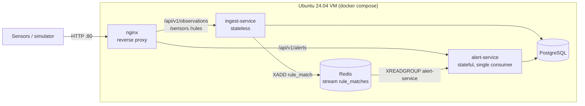
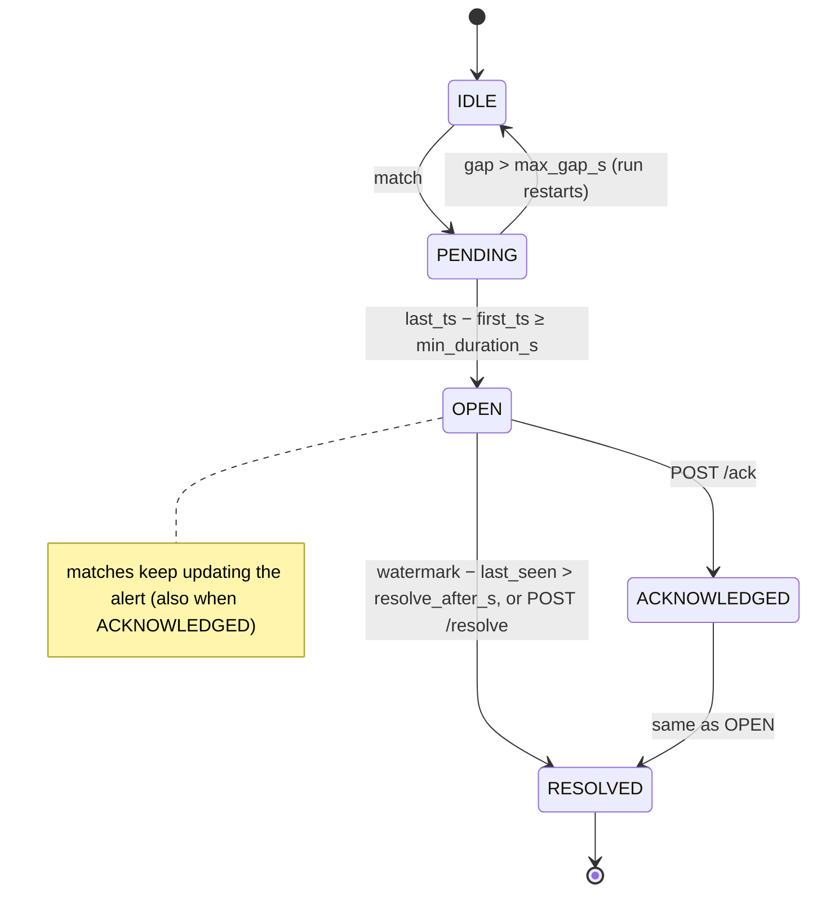
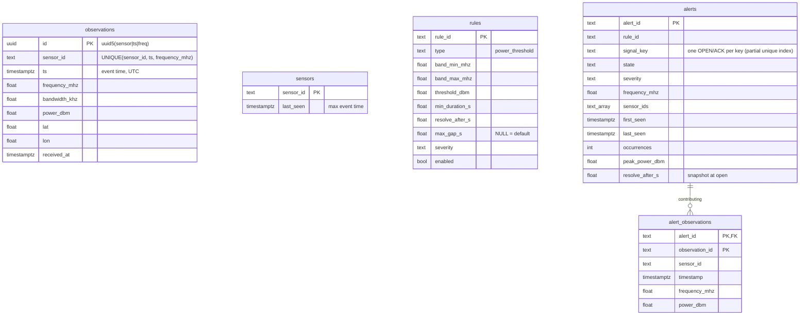
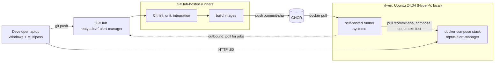

# Architecture

Why each choice was made is in [DECISIONS.md](DECISIONS.md); this file describes what exists.

## 1. Components



| Component | Owns | Does not |
|---|---|---|
| **nginx** | the only published port (80); routing; combined `/health` | hold state |
| **ingest-service** | validation, `observations`, `sensors`, `rules` tables, rule evaluation, publishing matches | decide whether an alert exists |
| **alert-service** | pending runs, watermark, `alerts` and `alert_observations` tables, alert lifecycle, auto-resolve sweep | read ingest's tables (all it needs travels in the event) |
| **Redis** | the `rule_matches` stream, consumer group `alert-service` (AOF on disk) | |
| **PostgreSQL** | durable data for both services (separate tables, one database) | |

Each service is layered the same way: `domain/` (pure Python logic and Protocols, no framework
imports), `adapters/` (Postgres, Redis, clock), `api/` (FastAPI + Pydantic), `main.py`
(composition root).

## 2. Data flow: one observation

```mermaid
sequenceDiagram
    participant S as Sensor
    participant N as nginx
    participant I as ingest-service
    participant P as PostgreSQL
    participant R as Redis
    participant A as alert-service
    S->>N: POST /api/v1/observations [batch]
    N->>I: proxy
    I->>I: validate all items (any invalid → 422, nothing stored)
    I->>P: BEGIN; INSERT … ON CONFLICT DO NOTHING RETURNING (new rows only)
    I->>P: upsert sensors.last_seen = max event time
    I->>I: evaluate each new observation against each enabled rule
    I->>R: XADD rule_matches (one event per match)
    I->>P: COMMIT
    I-->>S: 200 {accepted}
    R-->>A: XREADGROUP
    A->>A: drop if late (< watermark) or future (> clock + skew)
    A->>A: update pending run / open alert / update open alert
    A->>P: write alert + contributing observation
    A->>R: XACK
    loop every SWEEP_INTERVAL_S
        A->>P: resolve OPEN/ACK alerts with watermark − last_seen > resolve_after_s
    end
```

- Publishing happens **before COMMIT**, so a Redis failure rolls the request back (503) and the
  sensor retries. The deterministic `observation_id` makes a repeated event harmless
  (DECISIONS §7.1, [ADR 0001](docs/adr/0001-publish-before-commit.md)).
- Non-matching (weak) observations are stored but never published, so they cannot affect
  alert state.

### The `rule_match` event

```json
{
  "observation_id": "<uuid5>",
  "rule_id": "rule-ism-high-power",
  "sensor_id": "sensor-03",
  "timestamp": "2026-10-06T10:15:30Z",
  "frequency_mhz": 2437.0,
  "power_dbm": -42.5,
  "rule": { "min_duration_s": 10, "max_gap_s": 5, "resolve_after_s": 60, "severity": "HIGH" }
}
```

`rule` is a snapshot of the rule at evaluation time (with `max_gap_s` already defaulted), so
alert-service never reads the rules table.

## 3. Alert lifecycle

Per **signal key** = `rule_id` + frequency rounded to `FREQ_TOLERANCE_MHZ` (sensor is not part
of the key; several sensors feed one alert).



- PENDING lives only in memory; OPEN, ACKNOWLEDGED and RESOLVED are rows in `alerts`. A new
  match after RESOLVED starts a new run and later a new alert.
- **Event time everywhere.** `watermark = max event time − ALLOWED_LATENESS_S`. Events older
  than the watermark are dropped (counted); events too far in the future are dropped and do not
  move the watermark. If no event arrives for `IDLE_TIMEOUT_S`, the watermark advances with the
  wall clock so silent emitters still resolve (also right after a restart).
- Updates are order-independent (`first_seen=min`, `last_seen=max`, `peak=max`, sensor union),
  and an `observation_id` already in the alert is skipped (idempotent consumer).

## 4. Data model



- **ingest-service tables:** `observations`, `sensors`, `rules`. Indexes on `(sensor_id, ts)`
  (the unique key's prefix), `frequency_mhz` and `ts`.
- **alert-service tables:** `alerts`, `alert_observations`. `alert_observations` keeps its own
  copy of each contributing observation, so alert details never read ingest's tables.
- Each service applies its own idempotent `schema.sql` at startup. Rules are seeded from
  `ingest_service/config/rules.yaml` only when the table is empty.

## 5. Deployment topology



- **VM:** created by `infra/launch-vm.ps1` with `infra/cloud-init.yaml` (Docker, ufw 22/80
  only, bounded logs). Docker and the runner start on boot; containers use
  `restart: unless-stopped`.
- **Persistence:** named volumes `pgdata` and `redisdata`. `.env` (with the generated database
  password) lives only on the VM.
- **Pipeline:** CI on every push/PR → on green `main`, build both images tagged with the commit
  SHA → the runner on the VM pulls exactly that tag → smoke test → automatic rollback to the
  previous tag if it fails. Manual rollback: run the Deploy workflow with an older SHA
  (DECISIONS §9).
- **No inbound connection to the VM** is needed from GitHub: the runner connects out.
